# Data Pipeline with Docker

## Overview

This project runs an end-to-end, real-time data pipeline on a local machine, using Docker containers:

- **Apache Kafka**: streams data from the producers, which fetch or generate it, to the consumers and Cassandra sinks.
- **Apache Cassandra**: a NoSQL database that stores every stream in its own table.
- **Jupyter Lab**: loads the data from Cassandra for analysis and visualization.

The pipeline collects data from three sources:

| #   | Source                  | Kafka topic  | Cassandra table  | What it provides                                    |
| --- | ----------------------- | ------------ | ---------------- | --------------------------------------------------- |
| 1   | **OpenWeatherMap API**  | `weather`    | `weatherreport`  | Live weather for **Ho Chi Minh City** and **Tokyo** |
| 2   | **Faker**               | `faker`      | `fakerdata`      | Synthetic user profiles with 19 fields              |
| 3   | **USGS Earthquake API** | `earthquake` | `earthquakedata` | Real-time earthquakes worldwide                     |

## Instructions

Only OpenWeatherMap needs an API key. Faker runs locally, and the USGS feed is public with no key or sign-up.

- OpenWeatherMap API: https://openweathermap.org/api
- Faker: https://faker.readthedocs.io/en/master/providers.html
- USGS Earthquake API: https://earthquake.usgs.gov/earthquakes/feed/v1.0/geojson.php

> After you get an OpenWeatherMap API key, put it in `owm-producer/openweathermap_service.cfg`.

All commands below are run from the project root folder.

### 1. Create Docker networks

```bash
docker network create kafka-network
docker network create cassandra-network
docker network ls
```

### 2. Start Cassandra and Kafka

```bash
docker-compose -f cassandra/docker-compose.yml up -d
docker-compose -f kafka/docker-compose.yml up -d
docker ps -a
```

### 3. Open the Kafka manager UI (optional)

- Go to http://localhost:9000 and log in with **username** `admin` and **password** `bigbang`.
- Add a cluster: **Cluster Name** `MyCluster`, **Cluster Zookeeper Hosts** `zookeeper:2181`, check `Enable JMX Polling`, `Poll consumer information` and `Enable Active OffsetCache`, then save.
- You can now browse the `weather`, `faker` and `earthquake` topics.

### 4. Start the Cassandra sinks

Open a terminal in the **kafka-connect** container (Docker Desktop → kafka-connect → Exec, or `docker exec -it kafka-connect bash`), then run:

```bash
./start-and-wait.sh
```

This registers three sinks: `weathersink`, `fakersink` and `earthquakesink`.

### 5. Start the producers

```bash
docker-compose -f owm-producer/docker-compose.yml up -d
docker-compose -f faker-producer/docker-compose.yml up -d
docker-compose -f earthquake-producer/docker-compose.yml up -d
```

### 6. Start the consumers

All consumers share one image, so build it once first:

```bash
docker-compose -f consumers/docker-compose.yml up -d
```

Each consumer prints the messages it receives. Check them with `docker logs -f earthquakeconsumer` (or `weatherconsumer` / `fakerconsumer`).

### 7. Query the data in Cassandra

```bash
docker exec -it cassandra bash
cqlsh --cqlversion=3.4.4 127.0.0.1
```

```sql
cqlsh> desc keyspaces;
cqlsh> use kafkapipeline;
cqlsh:kafkapipeline> desc tables;
cqlsh:kafkapipeline> select * from weatherreport;
cqlsh:kafkapipeline> select * from fakerdata;
cqlsh:kafkapipeline> select username, name, email, phone, birthdate from fakerdata;
cqlsh:kafkapipeline> select * from earthquakedata;
cqlsh:kafkapipeline> select place, magnitude, latitude, longitude from earthquakedata;
```

`fakerdata` and `earthquakedata` have many columns, so it's easier to read if you select only a few.

### 8. Visualization

```bash
docker-compose -f data-vis/docker-compose.yml up -d
```

Go to http://localhost:8888, open a notebook, and choose **Run → Run All Cells**.
Let the producers run for at least a few hours first. Some weather charts (daily cycle, day length) need about a full day of data.

## Task 3 API: USGS real-time earthquakes

The **USGS Earthquake Hazards Program** publishes every earthquake detected worldwide as a free GeoJSON feed. It is updated every minute
and needs no API key or sign-up.

### 1. Features

- Real, live data: worldwide events, usually within minutes of them happening.
- Rich detail for each event: magnitude, depth, location, time, significance, number of "felt" reports, PAGER alert level, tsunami flag.
- Different time windows and minimum magnitudes: `all_hour`, `all_day`, `all_week`, `2.5_day`, `4.5_week`, `significant_month`, and others.

### 2. Usage in the project

- `earthquake-producer/earthquake_producer.py` polls the feed every 60 seconds (`USGS_FEED=all_day` by default).
- Each GeoJSON feature is flattened into one JSON message with 17 fields and sent to the `earthquake` topic.
- Events already sent are skipped. If USGS **revises** an event (e.g. a corrected magnitude), it is sent again.
  Because the USGS event `id` is the Cassandra primary key, a re-sent event updates the existing row instead of creating a duplicate.
- The `earthquakesink` writes the events into `kafkapipeline.earthquakedata`.

### 3. Fields

| Field                                                    | Description                                                                        |
| -------------------------------------------------------- | ---------------------------------------------------------------------------------- |
| `id`                                                     | USGS event ID (primary key)                                                        |
| `place`, `latitude`, `longitude`, `depth_km`             | Where it happened                                                                  |
| `magnitude`, `mag_type`                                  | Size, and the magnitude scale used                                                 |
| `event_time`, `updated_time`                             | When it happened, and when USGS last revised it (UTC)                              |
| `significance`, `felt_reports`, `alert_level`, `tsunami` | Impact indicators                                                                  |
| `status`, `event_type`, `network`, `url`                 | Review status, type (earthquake / quarry blast / …), reporting network, event page |

### 4. Configuration

Set `USGS_FEED` in `earthquake-producer/docker-compose.yml`. For more data in the analysis, use `all_week` or `2.5_week`.

## Faker fields (Task 2)

`fakerdata` stores 19 fields per user: `user_id`, `username`, `name`, `email`, `phone`, `birthdate`, `job`, `company`,
`address`, `city`, `postcode`, `country`, `passport_number`, `credit_card_provider`, `credit_card_number`,
`credit_card_expire`, `ip_address`, `user_agent`, `registered_at`.

## Data Visualization & Analysis

There is one notebook for each data source in `data-vis/python/`. Each notebook loads its table through `cassandrautils.py`,
so every chart uses the latest data in Cassandra. The plots below are from our run on **22-23 November 2026**. Because the data
is live, re-running the notebooks will give slightly different numbers.

### Weather: Ho Chi Minh City vs Tokyo (`weather_analysis.ipynb`)

The weather data covers about 5 hours (13:00-17:40 UTC on 23 Nov). That is the **evening and night** in both cities
(20:00-00:40 in HCMC, 22:00-02:40 in Tokyo).

#### 1. Temperature over time

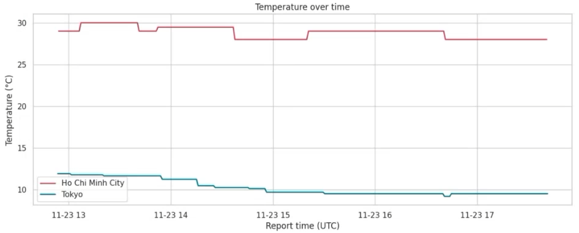

Ho Chi Minh City stays between **28 and 30 °C**, while Tokyo cools from about **12 °C to 9.5 °C** during the night, so the two cities are
almost 20 °C apart. This is the difference between a tropical climate near the equator and a temperate city in late autumn.
The lines are step-shaped because OpenWeatherMap only updates its readings every few minutes.

#### 2. "Feels like" vs actual temperature

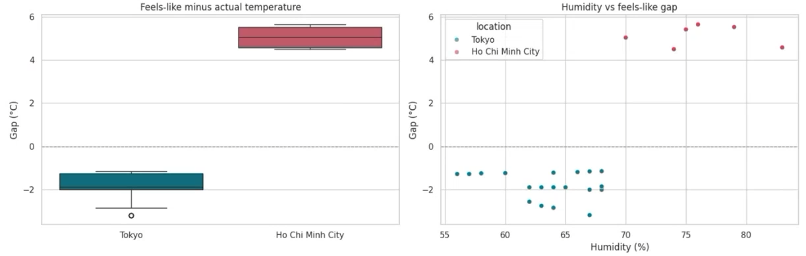

The left chart shows the feels-like temperature minus the actual temperature. In HCMC the air feels **4.5-5.6 °C hotter** than it is,
while in Tokyo it feels **1-3 °C colder**. The scatter plot shows why: HCMC's humidity is **70-83 %**, and humid air stops sweat from
evaporating, so the body cannot cool down. Tokyo is drier (56-68 %) and windier, so wind chill makes it feel colder.
This is the most useful weather finding for people living or working in HCMC: the thermometer underestimates the heat stress.

#### 3. Daily temperature cycle (local time)

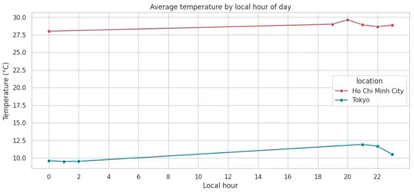

The average temperature for each local hour. We only have evening and night hours so far, so the chart shows the night-time
cooling, which is clear in Tokyo (from ~12 °C at 21:00 to ~9.5 °C at 01:00-02:00), while HCMC barely changes (28-30 °C).
Tropical nights stay warm because humid air holds heat. With a full day of data, this chart would show the complete daily cycle.

#### 4. Day length

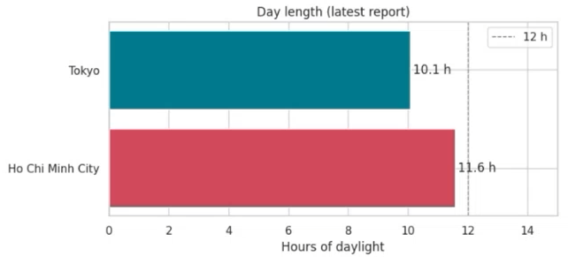

Calculated from the sunrise and sunset timestamps: HCMC has **11.6 hours** of daylight and Tokyo only **10.1 hours**.
HCMC (10.8°N) is close to the equator, so its days stay near 12 hours all year. Tokyo (35.7°N) is further north and it is
almost winter, so its days are much shorter. This is the effect of latitude, measured directly from the API data.

#### 5. Wind and pressure

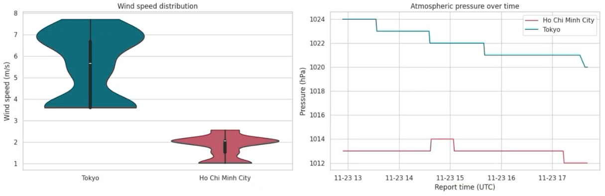

Tokyo is much windier (**3.6-7.7 m/s**) than HCMC (**1-2.6 m/s**). Tokyo's pressure dropped steadily from **1024 to 1020 hPa**
over the 5 hours, which often comes before a change in the weather, while HCMC's pressure stayed flat around 1012-1014 hPa,
which is typical for the tropics.

#### 6. Weather conditions

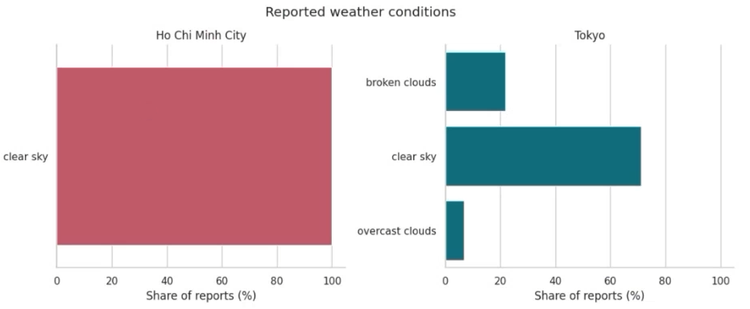

HCMC reported **clear sky 100 %** of the time, which is normal for late November, the start of its dry season.
Tokyo was mostly clear (~71 %) with some broken (~22 %) and overcast (~7 %) clouds, matching the falling pressure in plot 5.

#### 7. Correlation between weather variables

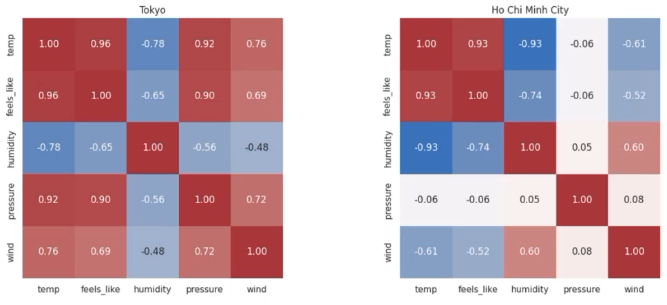

In HCMC, temperature and humidity are strongly **negatively** correlated (**-0.93**). Relative humidity rises as the air cools,
even when the amount of water in the air stays the same. In Tokyo, temperature and pressure show a high correlation (0.92), but
this is **not** cause and effect: both simply went down during the same short window. This is a good reminder that correlations
from a few hours of data need care.

### Earthquakes (`earthquake_analysis.ipynb`)

The earthquake data covers about 29 hours (12:00 UTC on 22 Nov to 17:00 UTC on 23 Nov), with about **270 earthquakes**.

#### 8. Earthquake locations

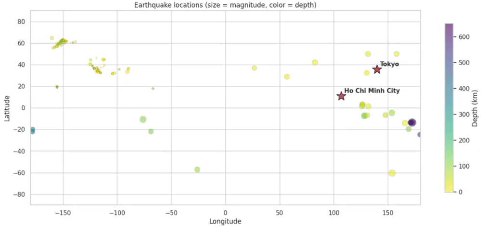

Each dot is an earthquake: bigger means stronger, and color shows depth. We only plotted latitude and longitude with no map
background, yet the plate boundaries are already visible: Alaska, the US west coast, Indonesia, the western Pacific and the
Vanuatu-Fiji region, which are all part of the **Pacific Ring of Fire**. The dark purple dots in the South Pacific are very deep
earthquakes (~600 km). The two stars mark our weather cities.

#### 9. Magnitude distribution (Gutenberg-Richter law)

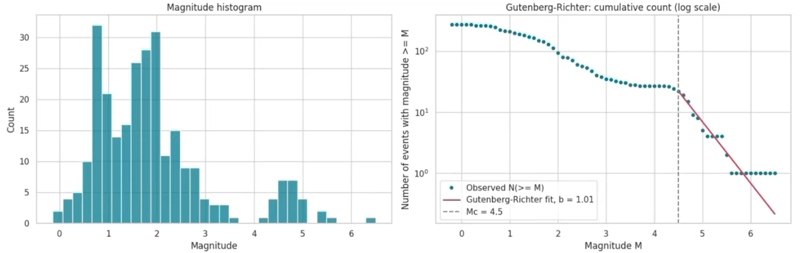

Most recorded earthquakes are small (M0.5-2.5). On the right, the cumulative count on a log scale follows the **Gutenberg-Richter
law**: above M4.5 the points lie on a straight line, and our fitted **b-value is 1.01**, almost exactly the value of about 1 that
seismology predicts. That means each step of +1 magnitude is about **10× rarer**. Below M4.5 the curve flattens. This is not
real geology: small earthquakes outside the US are simply not detected, so we only fit the line above M4.5.

#### 10. Depth vs magnitude

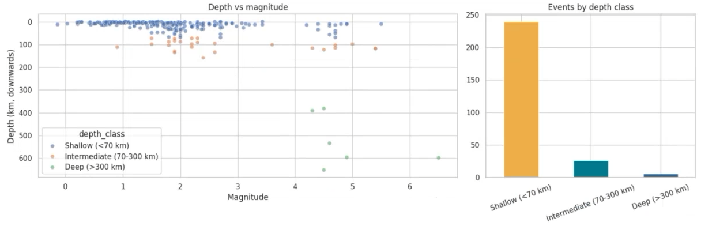

Almost all earthquakes (~240) are **shallow** (< 70 km), about 25 are intermediate (70-300 km), and only 5 are **deep** (> 300 km).
The deep ones are all **M4.3 or larger**, including the strongest event (M6.5 at ~600 km). Deep earthquakes only happen where an
ocean plate dives under another plate, and small deep earthquakes are too far from the surface sensors to be detected.

#### 11. Detection bias between seismic networks

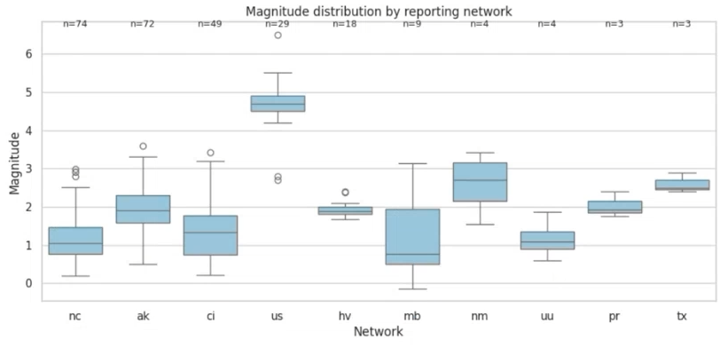

Each event is reported by a seismic network. Regional US networks such as `nc` (Northern California), `ci` (Southern California) and
`ak` (Alaska) report many quakes with a median around **M1-2**, because they have dense local sensors. The global `us` network has a
median around **M4.7**, because outside the US only larger quakes are detected. So **a region with more events is not necessarily
more dangerous**. It may just have more sensors.

#### 12. Activity over time

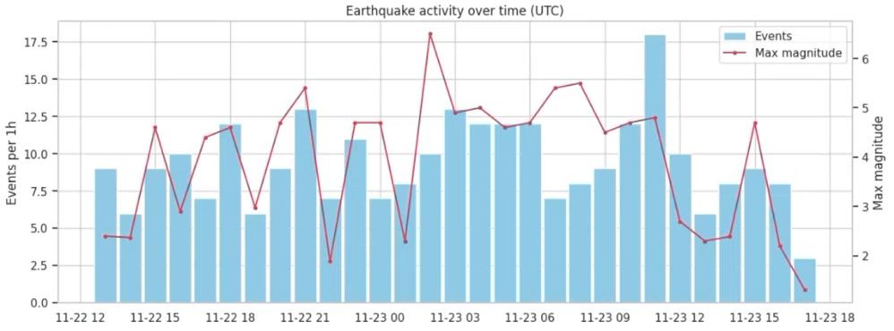

Between **3 and 18 earthquakes per hour** were recorded, with no clear daily pattern, as expected, since earthquakes do not follow
the clock. The red line shows the strongest event in each hour. The peak is the **M6.5** deep earthquake around 02:00 UTC on 23 Nov.
Large and small events are spread randomly over time.

#### 13. Earthquakes near Tokyo and Ho Chi Minh City

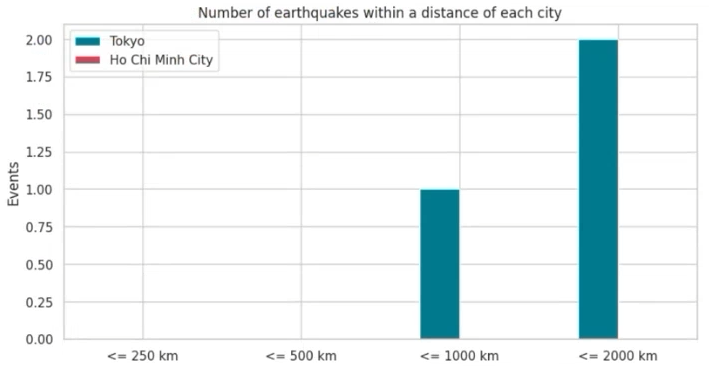

This links the earthquake data back to our weather cities, using the haversine (great-circle) distance. In this period
Tokyo had **1 earthquake within 1,000 km** and 2 within 2,000 km, while HCMC had **none** within 2,000 km. Japan sits where four
tectonic plates meet, while southern Vietnam is far from any active plate boundary. The two cities face different natural risks:
**heat and humidity in HCMC, earthquakes in Tokyo**.

#### 14. Most active regions

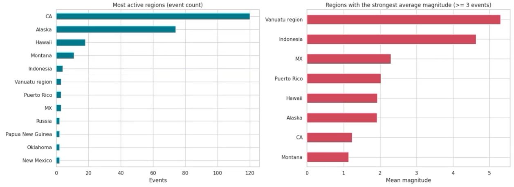

By event count, **California (~120)** and **Alaska (~74)** lead by far, but that is detection bias again (plot 11). Ranked by
**average magnitude** (left out: regions with fewer than 3 events), the **Vanuatu region (~M5.3)** and **Indonesia (~M4.6)** come
first. These are the truly powerful subduction zones, while California's many quakes average only about M1.2.

### User profiles (`user_profile_analysis.ipynb`)

Faker data is random, so these plots check it the way a data engineer would check a new user data stream. About
**3,250 user profiles** were analysed.

#### 15. Logical consistency checks

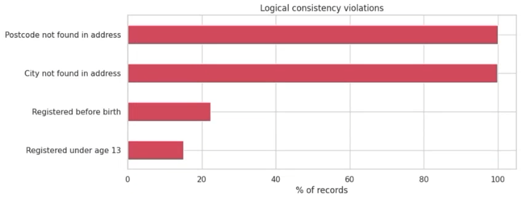

Every field is filled in and every `user_id` is unique, but checking fields **against each other** finds impossible records:

- the `postcode` and `city` don't match the address in almost **100 %** of records;
- **~22 %** of users registered **before they were born**;
- **~15 %** registered while under 13.

This happens because Faker generates each field independently. Each value looks correct on its own, but the record as a whole doesn't
make sense. A real pipeline should run cross-field checks like these before trusting incoming data.

#### 16. Age distribution

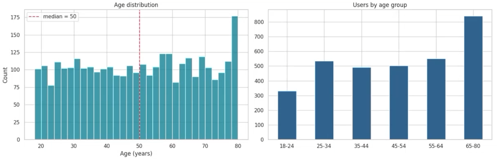

Ages are spread **evenly from 18 to 80** (median 50), because Faker picks birthdates uniformly. The 65-80 group looks biggest only
because it covers **16 years**, while the others cover 10 (and 18-24 only 7). If you divide by the width of each group, they are
all about the same size. This is a reminder to check bin widths before reading a bar chart. A real user base would usually be
concentrated in a few age groups.

#### 17. Registration trend

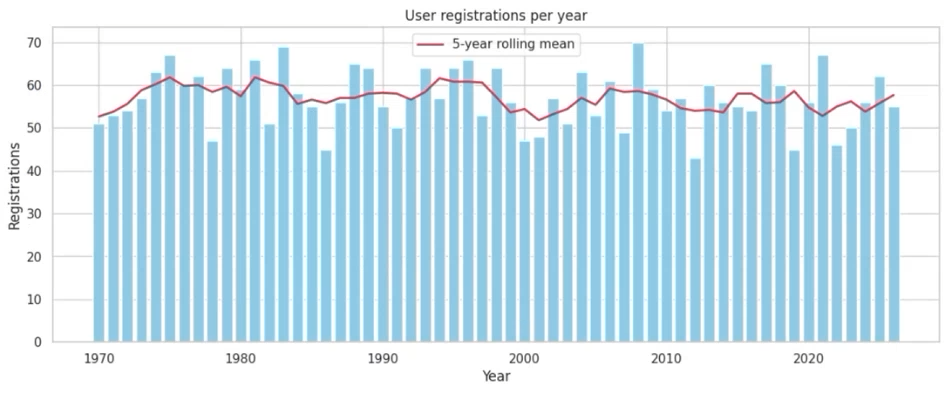

Registrations are flat at about **45-70 per year from 1970 to 2026**. Faker picks a random date between 1970 (the start of Unix time)
and today. This is also the cause of the "registered before birth" problem in plot 15: a user born in 1990 can get a
registration date in 1975. A real platform would show growth starting from its launch date.

#### 18. Payment cards

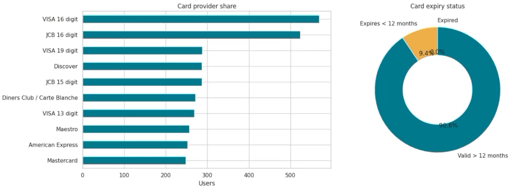

**VISA 16-digit and JCB 16-digit appear about twice as often** as the other providers (~550 vs ~260 users). We checked Faker's
source: its list of card types includes `visa` and `jcb` as extra names for the 16-digit versions, so they get picked twice as
often. The expiry chart shows **0 % expired** cards, because Faker always generates expiry dates in the future, and **9.4 %**
of cards expire within the next 12 months. A real business would use that 9.4 % to remind customers to update their payment details.

## Practical Implication of the Project

### Scenario

A company has offices and staff in **Ho Chi Minh City** and **Tokyo**, and runs an online platform with user accounts.
It needs one place to monitor the environmental risks in both cities and to check the quality of the user data entering its systems.

### How the pipeline helps

- **Heat risk in HCMC:** the weather stream tracks temperature, humidity and the "feels like" gap in real time. This could trigger
  heat warnings for outdoor staff when humidity pushes the felt temperature up.
- **Earthquake risk in Tokyo:** the earthquake stream shows, within minutes, the earthquakes close to each office. Magnitude, depth,
  alert level and tsunami flag could be used to send staff safety alerts.
- **User data quality and privacy:** the user stream shows how to validate incoming records before trusting them (completeness,
  duplicates, impossible combinations) and how to mask personal data before it reaches a dashboard.

### Role of the big data stack

- **Real-time streaming (Kafka):** data flows continuously, so insights are minutes old, not days.
- **Easy to extend:** each source is just a producer + topic + sink. The earthquake source was added without changing any
  existing component.
- **Scalable storage (Cassandra):** each stream has its own table, with primary keys chosen so that re-sent data overwrites
  the existing row instead of creating duplicates.
- **Reproducible analysis (Jupyter):** notebooks read directly from Cassandra, so re-running them always shows the latest state.

## Demonstration Video

Link: https://youtu.be/3xjrTmEjwp0
